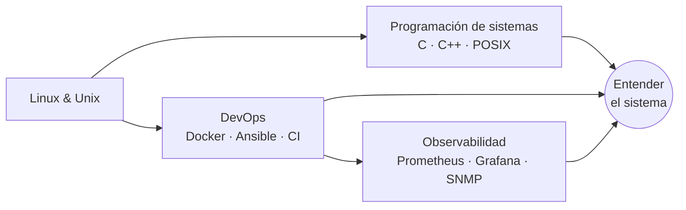

<div align="center">


<br><br>
 
<a href="https://github.com/MasterCodeMFE"></a>


 
</div>
<br>
```console
manuel@linux:~$ whoami
Manuel Fernández · DevOps · Estudiante en 42 Madrid
 
manuel@linux:~$ echo $PHILOSOPHY
"Entender la infraestructura que opero, no solo las herramientas que se ejecutan sobre ella."
```
 
---
 
## 🧭 Qué hago
 
<table>
<tr>
<td width="25%" align="center"><h3>🐧</h3><b>Linux & Unix</b><br><sub>Internals, POSIX, procesos, señales, TTY/PTY</sub></td>
<td width="25%" align="center"><h3>⚙️</h3><b>DevOps</b><br><sub>Automatización, contenedores, despliegue</sub></td>
<td width="25%" align="center"><h3>📊</h3><b>Observabilidad</b><br><sub>Prometheus, Grafana, SNMP, Blackbox</sub></td>
<td width="25%" align="center"><h3>💻</h3><b>Sistemas</b><br><sub>C y C++ cerca del sistema operativo</sub></td>
</tr>
</table>
---
 
## ⚡ Stack
 
<div align="center">

<br><br>
 


</div>
---
 
## 🚀 Proyectos destacados
 
<table>
<tr>
<td width="50%" valign="top">
### 📂 [ft_ls](https://github.com/MasterCodeMFE/42-ft_ls)
Reimplementación de `ls` en C: formato largo, recursividad, ordenación por fecha, enlaces simbólicos y múltiples rutas.
 
`C` `POSIX` `stat` `lstat` `dirent`
 
</td>
<td width="50%" valign="top">
### 🖥️ ft_select
Interfaz interactiva de terminal sin frameworks: selección, señales, redimensionado y renderizado dinámico.
 
`termios` `termcaps` `ioctl` `raw mode`
 
</td>
</tr>
<tr>
<td width="50%" valign="top">
### 🎥 [ft_script](https://github.com/MasterCodeMFE/ft_script)
Reimplementación de `script` con pseudo-terminales para grabar sesiones de terminal.
 
`PTY` `fork` `wait` `terminal I/O`
 
</td>
<td width="50%" valign="top">
### 🐚 [Babuterm](https://github.com/MasterCodeMFE/Babuterm)
Shell Unix propia con pipes, redirecciones, variables de entorno, built-ins y señales.
 
`procesos` `pipes` `file descriptors`
 
</td>
</tr>
<tr>
<td width="50%" valign="top">
### 🌐 [Webserv](https://github.com/MasterCodeMFE/webserver)
Servidor HTTP en C++ con parser, routing, CGI y E/S no bloqueante.
 
`C++` `HTTP` `sockets` `TCP/IP`
 
</td>
<td width="50%" valign="top">
### 🐳 [Inception](https://github.com/MasterCodeMFE/inception)
Infraestructura con Docker: NGINX + WordPress + MariaDB, con redes y volúmenes persistentes.
 
`Docker` `NGINX` `MariaDB` `volúmenes`
 
</td>
</tr>
</table>
### 🔎 Cómo encaja todo
 

 
---
 
## 🎓 42 Madrid
 
<details>
<summary><b>Ver currículo completado</b></summary>
<br>
| Área | Proyectos |
|:---|:---|
| 🧱 Fundamentos de C | Libft · ft_printf · get_next_line |
| 🧠 Algoritmos | push_swap |
| 📡 IPC | minitalk |
| 🐚 Unix | Babuterm |
| 🧵 Concurrencia | Philosophers |
| 🎨 Gráficos | FdF · cub3d |
| ⚙️ C++ | CPP Modules |
| 🌐 Networking | Webserv |
| 🐳 Infraestructura | Inception |
| 🌍 Web | ft_transcendence |
| 🐧 Linux internals | ft_ls · ft_script · ft_select |
 
</details>
---
 
## 🧩 Objetivos actuales
 
```console
manuel@linux:~$ ./current_quest
 
[+] Profundizar en los internals de Linux
[+] Construir sistemas de monitorización
[+] Automatizar tareas repetitivas de infraestructura
[+] Comprender networking en profundidad
[+] Seguir construyendo proyectos en C
 
Status: RUNNING...
```
 
---
 
## 📊 Telemetría de GitHub
 
<div align="center">


<br>

<br><br>
 

<br>

</div>
---
 
<div align="center">
### 🌐 Contacto
 
<a href="https://github.com/MasterCodeMFE"></a>
<!-- <a href="https://www.linkedin.com/in/TU-PERFIL"></a> -->
<!-- <a href="mailto:tu@correo.com"></a> -->
 
<br>
`manuel@linux:~$ exit`  
*El proceso sigue en ejecución...*
 

</div>
 
